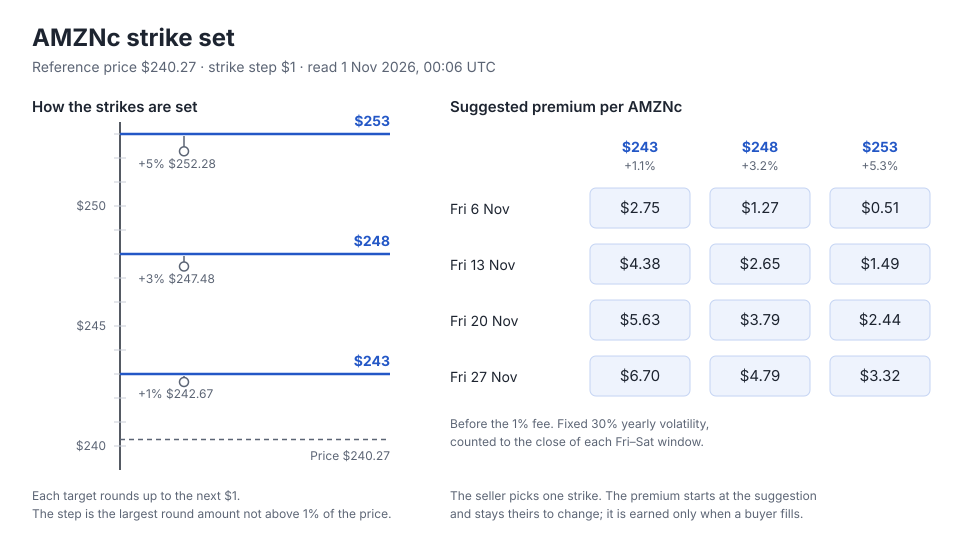

# Covered calls — strike design

**Status:** Built · 1 November 2026. Approved by the chief engineer under Sean's standing order (1a 2a 3a 4a 5a, 1 Nov 00:20Z), with the Autolaunch chief's three review fixes.

**Brief:** [yield-borrow-spec.md](yield-borrow-spec.md) line 19, "Offer a small set of quoted strikes
and expiries" (AL-CC-SPEC, Sean 28 Oct, confirmed "5a" 31 Oct). It replaces the 13 Oct "no strike
menu yet".

**Contract:** unchanged. `CoveredCallsV1.list` takes any strike above zero; the set below is a site
and agent-tool rule only.



## Live today

The Sell form takes any strike the seller types. Beside it the guide suggests a premium at three
strikes, the reference price plus 1%, 3% and 5% rounded to the cent, each with a Use button that fills
the form (`@suggested_strikes` in `AutolaunchWeb.CoveredCallsLive`). The premium is Black-Scholes at a
fixed 30% yearly volatility, no interest, counted to the close of the exercise window
(`Autolaunch.CoveredCalls.Quote`). It is not offered while the Chainlink price is older than four
days. `autolaunch_covered_call_quote` prices one strike and expiry the caller names.

Two sellers aiming at "3% above" a few minutes apart list, for example, $247.48 and $247.61, so the Buy tab fills with
strikes nobody can compare.

## The quoted set

For each of the four weekly expiries the page already offers (the next four Fridays, 21:00 UTC), three
strikes:

1. **Strike step:** the largest of $0.01, $0.05, $0.10, $0.25, $0.50, $1, $2.50, $5, $10 and $25 that
   is not above 1% of the reference price, and $0.01 for a price under $1. AMZNc at $240.27 gives $1.
2. **Strikes:** the reference price plus 1%, 3% and 5%, each rounded **up** to the strike step and at
   least one step above the one before it (the first, above the price). From $1 up the targets are
   2% apart and a step is at most 1%, so the rounding alone keeps them apart; under $1 the one-step
   rule does: $0.30 gives $0.31, $0.32 and $0.33.
3. **Suggested premium:** today's formula, unchanged, rounded to the cent with a $0.10 floor, as the
   page rounds it now.
4. **The price it moves with:** the Chainlink reading in the shared book (at most five minutes old, ten
   seconds after a landed step). When the price is more than four days old the strikes still come from
   the last price, shown with its age, and the premium is left for the seller to type. The set never
   disappears, so the List button is never held back by the price.

Worked set from the live feed on Base (answer $240.27125, updated 30 Oct 19:54 UTC, read at block time
1 Nov 00:06 UTC); premiums from `Terms.suggested_premium/5` run on these inputs:

| Window | $243 (+1.1%) | $248 (+3.2%) | $253 (+5.3%) |
| --- | --- | --- | --- |
| Fri 6 Nov | $2.75 | $1.27 | $0.51 |
| Fri 13 Nov | $4.38 | $2.65 | $1.49 |
| Fri 20 Nov | $5.63 | $3.79 | $2.44 |
| Fri 27 Nov | $6.70 | $4.79 | $3.32 |

Because every strike sits on the step grid, sellers land on the same strikes while the price moves less than a
step, and a buyer sees a few strikes with several listings each.

## What the seller sees

- **Amount** and **Window**, as now.
- **Strike:** three choices for the window picked, each showing the strike, how far above the price it
  is, and the suggested premium; the middle one is chosen to start. The typed strike field goes.
  The form keeps the position chosen (low, middle, high), so a new price reading moves the strike
  and keeps the choice. When the feed gives no answer at all there are no strikes until the next
  reading, and the form says so.
- **Premium:** choosing a strike or a window puts that strike's suggestion in the premium. The seller
  may change it; it is still the minimum a buyer pays. With no fresh price it starts empty.
- **Guide:** the result at three prices and the after-fee premium follow the strike and premium chosen,
  as they follow the typed ones today. The separate suggestions table and its Use buttons go, since
  the choices replace them.
- **Words:** "The strike is the price you agree to sell at." The figures say they are a suggestion
  from a fixed 30% volatility, not a buyer's offer: the premium is earned only when a buyer fills.

The Buy tab is unchanged in this step. Grouping its rows by strike can follow once the set is live.

## Agent tool shape

`autolaunch_covered_call_quote` returns the whole set; it no longer takes a strike or an expiry.

- **Input:** `{ "symbol": "AMZNc" }`
- **Route:** `GET /api/v1/covered-calls/{symbol}/quote`, read only, no sign-in (was `POST` with a
  strike and an expiry).
- **Output:**

```json
{
  "symbol": "AMZNc",
  "price_per_token": 240271250,
  "price_updated_at": 1793390057,
  "price_fresh": true,
  "volatility_bps": 3000,
  "strike_step": 1000000,
  "windows": [
    {
      "expiry": 1793998800,
      "window_closes_at": 1794085200,
      "strikes": [
        {
          "strike_per_token": 243000000,
          "above_bps": 114,
          "suggested_premium_per_token": 2750000,
          "fee_per_token": 27500
        }
      ]
    }
  ]
}
```

Every figure is a whole number: USDC in micro-USDC per whole token, as in every covered-call tool,
and `above_bps` and `volatility_bps` in basis points (`above_bps` rounded half up), so an agent never
reads a decimal. The page's "+1.1%" is worked out from the strike and the price, not from
`above_bps`. `suggested_premium_per_token` and `fee_per_token` are `null` when `price_fresh` is false.

`autolaunch_covered_call_prepare` with `kind: "list"` keeps its inputs. It prepares any strike the agent
names, as the contract accepts any strike (decision 2). The route moved from `POST` to `GET` in one
release with the HTTP spec (`platform/contracts/covered-calls.openapiv3.yaml`) and the tool file
(`platform/priv/covered_calls_tools.json`); nothing answers the old `POST`. The regents CLI has no
covered-call command yet; its `covered-calls quote <symbol>` is built against this shape by the
regents-cli lane.

## Decisions (all a)

1. **How the set is spread.**
   - a) The live +1%, +3%, +5%, rounded up to the step, the same for every Friday. Chosen: the
     percents Sean already reviewed on the page, one rule a person can check by hand.
   - b) Spread by time: 0.25, 0.75 and 1.25 of the expected move to each Friday, so the chance of being
     exercised is about the same in every window (for 27 Nov: $246, $256, $266). Fairer across
     windows, but harder to explain.
2. **Strikes off the set.**
   - a) The page offers only the set; agents may still prepare any strike, because the contract takes
     any strike and the site never refuses what the chain would accept. Chosen.
   - b) The site also refuses an agent's off-set strike. It would race the price: a set read a minute
     earlier can be refused on prepare.
3. **Quote source.**
   - a) Keep the Chainlink price and the fixed 30% model, labelled a suggestion. Chosen for the
     first stock: no new source to qualify; the buyer's fill is the executable quote.
   - b) Volatility from the feed's own last 30 days of prices. Closer to the market, but a new
     calculation to prove.
4. **Expiry rules.**
   - a) Unchanged: the next four Fridays at 21:00 UTC and the 24-hour window after. A window that
     closes after a scheduled change to the stock's multiplier stays offered; its List step comes back
     blocked with the reason, as now, because the contract refuses it. Chosen.
   - b) Also drop a Friday less than a day away. Its premium is cents and fills close at expiry.
5. **Premium and Credits.**
   - a) USDC only, as the spec and the deployed contract have it. Chosen: Credits would need a new
     contract.
   - b) Credits as well, in a later contract.

## Built

No contract change and no deploy. The Sell form, the quote tool and route, their tests, the journey
and [covered-calls-design.md](covered-calls-design.md) changed together in one branch.
